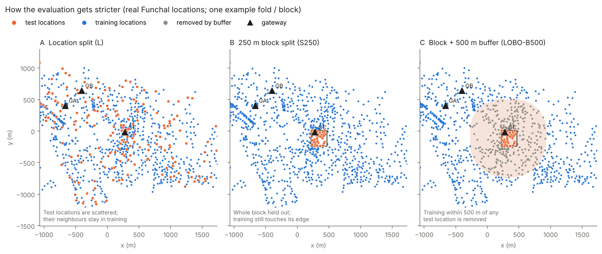
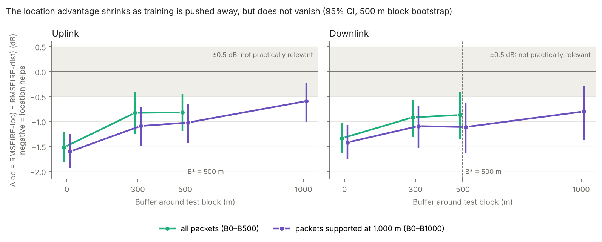
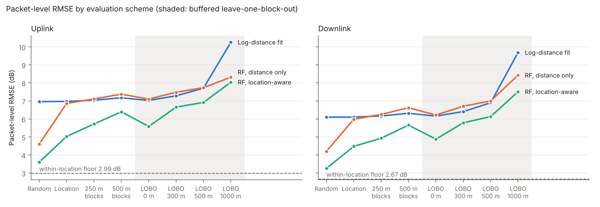
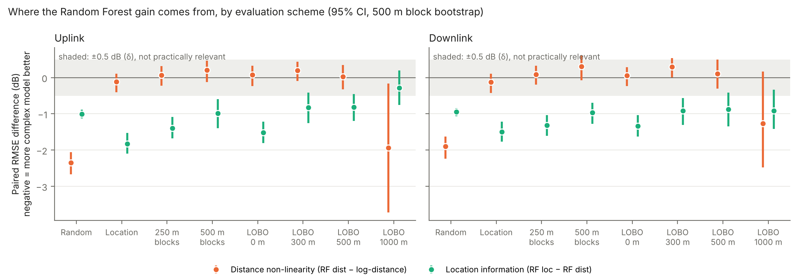
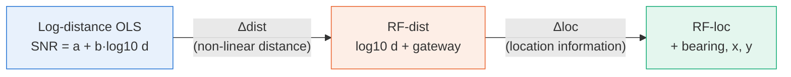
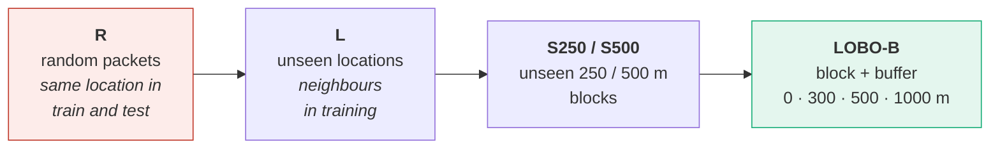
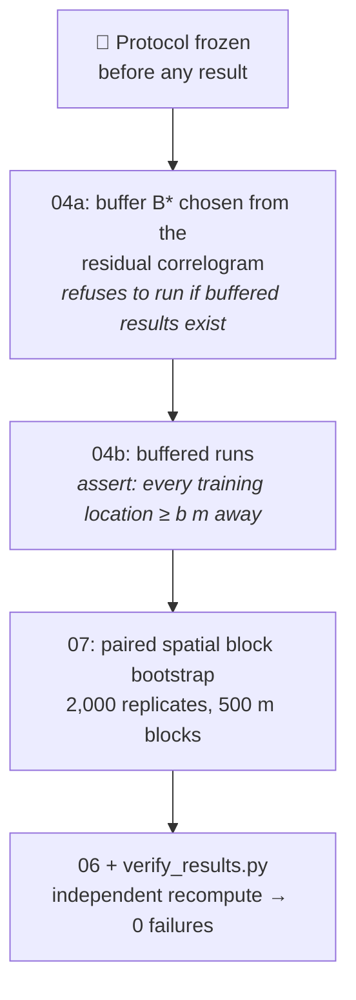
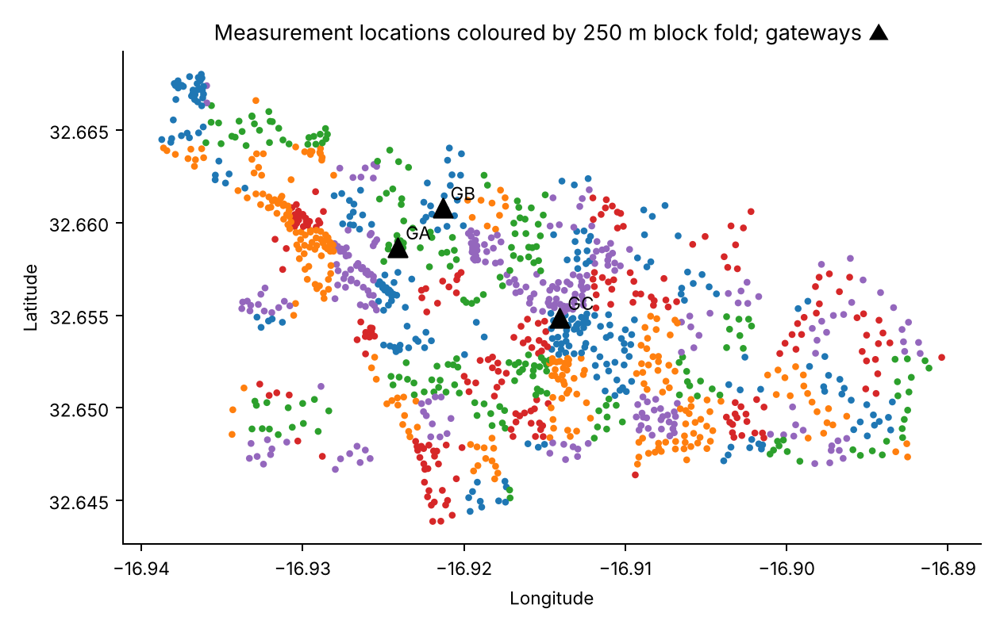
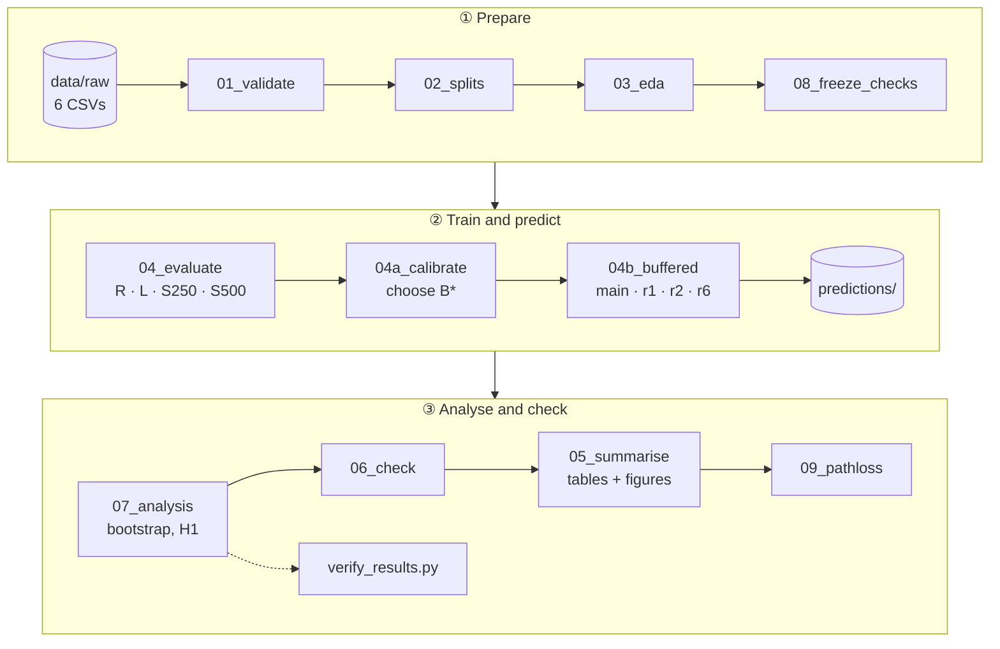

<div align="center">

# 📡 Does location really help predict LoRa SNR?

### Spatially buffered evaluation of geography-based Random Forest regression for LoRa signal-to-noise ratio


*Course research project for topic 5: RF Prediction. Regression models to predict Signal-to-Noise Ratio, and channel modelling for RF communication systems.*

</div>

---

## 🧭 The project in 30 seconds

Machine-learning models that know **where** a device is (x, y, bearing to the gateway) predict LoRa SNR much
better than models that only know the **distance**. But SNR is spatially correlated. When a test point has a
training point 20 m away, the model can simply "look up" its neighbour.

**So is the location advantage real generalisation, or spatial leakage?**

We hold out whole 250 m blocks of the city and remove every training location within a buffer of
**0 / 300 / 500 / 1,000 m**. Then we measure how much of the location advantage survives.

<p align="center">
  
</p>

> **Answer:** once training data is ≥ 500 m away, the advantage shrinks by 46% (uplink) and 35% (downlink).
> The remaining 0.8–0.9 dB is still there, so position does carry information beyond the distance curve. Under our
> pre-registered ±0.5 dB rule the result is formally **inconclusive**, and it is sensitive to the Random
> Forest leaf size.

---

## 📊 Key results

<p align="center">
  
</p>

| Question | Finding | Verdict |
| :-- | :-- | :-: |
| **H1:** does the location advantage survive a 500 m buffer? | Δloc = −0.82 dB [−1.20, −0.46] uplink, −0.87 [−1.35, −0.42] downlink. Smaller than at 0 m (−1.52 / −1.34), still ≠ 0, but not entirely beyond −0.5 dB | 🟡 inconclusive |
| **H2:** does the RF learn a better distance curve? | RF-dist ≈ log-distance OLS under every grouped split, so the gain is **location**, not distance | 🔴 not supported |
| **H3:** are random splits optimistic? | RMSE ordering random < location < 250 m < 500 m blocks; every paired CI excludes 0 | 🟢 supported |
| **H4:** does irreducible noise dominate? | Within-location floor 2.99 / 2.67 dB; its share of MSE falls from 0.35 to 0.13–0.14 as separation grows | 🟢 supported |
| **H5:** are weak links over-predicted? | With 1–2 received packets: +5.0 dB (uplink S250), +7.7 dB (uplink LOBO 500 m) | 🟢 supported (descriptive) |

<details>
<summary><b>RMSE of the location-aware Random Forest by evaluation scheme (dB)</b></summary>

| Direction | Random | Location | 250 m blocks | 500 m blocks | LOBO 0 m | LOBO 300 m | LOBO 500 m | LOBO 1,000 m | Floor |
| --- | --- | --- | --- | --- | --- | --- | --- | --- | --- |
| Uplink | 3.61 | 5.03 | 5.72 | 6.40 | 5.58 | 6.65 | 6.92 | 8.04 | 2.99 |
| Downlink | 3.26 | 4.48 | 4.93 | 5.66 | 4.88 | 5.79 | 6.13 | 7.51 | 2.67 |


</details>

<details>
<summary><b>Where the Random Forest gain comes from: distance vs location</b></summary>



The orange points (RF-dist − log-distance) sit at about 0 under every honest split, so the extra flexibility in
distance buys nothing. All the gain is in the green points (RF-loc − RF-dist), which is location information.
</details>

**Other findings**
- 🗺️ The location advantage that survives at 500 m is concentrated at **gateway GC**.
- 📐 Residual spatial correlation is **not eliminated** at 500 m: the upper CI reaches 0.226. So we never call the test set "spatially independent".
- 📡 **Channel-model check:** our path-loss fit reproduces the dataset paper's Table 3 (α 42.7 / 54.8 / 44.0 dB, β 2.79 / 2.37 / 2.93).

---

## 🔬 How it works

### The decomposition being tested



### Evaluation schemes, from leaky to strict



### Models (no RSSI, no packet counts: geometry only)

| ID | Model | Inputs |
| :-: | :-- | :-- |
| M0 | `mean` | per-gateway training mean |
| M1 | `logdist` | per-gateway OLS of SNR on log10 d (empirical, not a path-loss model) |
| M2 | `rf_dist` | Random Forest: log10 d + gateway |
| M3 | `lr_loc` | linear regression: log10 d, sin/cos bearing, x, y, gateway |
| M4 | `rf_loc` | Random Forest: log10 d, sin/cos bearing, x, y, gateway (**main model**) |

### Safeguards against fooling ourselves



---

## 🗂️ Dataset

**A Large-Scale LoRa Measurement Campaign in Urban and Suburban Environments**, by Azevedo and Mendonça.
Mendeley Data, DOI [10.17632/79vh7wnwhg.1](https://doi.org/10.17632/79vh7wnwhg.1), CC BY 4.0.

| | |
| :-- | :-- |
| 📍 Area | Funchal, Madeira (Portugal) |
| 📶 Radio | LoRa SF12, 125 kHz, 868.1 / 868.3 / 868.5 MHz, 14 dBm |
| 🏢 Gateways | 3 (GA, GB, GC) |
| 📌 Locations | 1,203 fixed device positions, 8 packets each |
| 📦 Received packets | 37,029 (18,519 uplink · 18,510 downlink) |
| 🎯 Target | SNR (dB) of *received* packets, modelled per direction |

<details>
<summary>Map of the measurement locations</summary>

</details>

---

## 🚀 Quick start

```bash
git clone https://github.com/HarshitaShibe/AI_For_Electronics_Research_Paper.git
cd AI_For_Electronics_Research_Paper
pip install -r requirements.txt
```

**Option A: reproduce every number without retraining (about 2 min).**

First download `predictions.zip` from **Releases** and unzip it into the repo folder.

```bash
python 06_check.py               # integrity checks      -> "OK: 44 prediction files checked ..."
python tools/verify_results.py   # independent recompute -> "0 failure(s)"
python 07_analysis.py            # all statistics + H1 verdict
python 05_summarise.py           # Tables 1-6, Figures 1-4
```

You can also open **`demo.ipynb`** and choose *Kernel → Restart & Run All*. It includes a live training run on 12
blocks (about 2–3 min).

**Option B: full rerun from the raw CSVs (about 3–4 h on 2 cores).**

```bash
bash run_all.sh
```

---

## ⚙️ Pipeline



Each stage reads only earlier outputs and writes to disk, so every number can be traced back to a file.

---

## 📁 What each file does

<details open>
<summary><b>Pipeline scripts</b> (in run order)</summary>

| File | What it does | Main outputs |
| --- | --- | --- |
| `common.py` | Shared helpers: paths, global seed (`20251028`), column names that fix two raw-header quirks, documented link parameters, raw reader, haversine distance, bearing, local x/y projection | imported by all |
| `models.py` | **Model definitions** M0–M4 and the appendix models, feature sets `FEAT_DIST` / `FEAT_LOC`, and `tune_rf`. Tuning is an inner grouped 3-fold search over leaf {5, 20, 50} × max_features {0.5, 1.0}, with 200 trees | imported by 04, 04a, 04b |
| `01_validate.py` | Loads the six raw files, runs hard schema and consistency asserts, builds tidy tables | `data/processed/*.csv`, `results/validation_report.*` |
| `02_splits.py` | Assigns folds once, per location: R, L, S250, S500, shifted grids and seeds, 1,000 m blocks. Builds the buffer masks and asserts each kept training location is ≥ b away | `splits/*` |
| `03_eda.py` | Descriptive plots and fits on the whole dataset (not evaluation results) | `results/eda/`, `figures/eda_*` |
| `08_freeze_checks.py` | Feasibility of buffers and bootstrap blocks, from geometry only (no SNR, no fitting) | `results/freeze_checks/` |
| `04_evaluate.py` | Grouped schemes with separate inner tuning of `rf_dist` and `rf_loc`. Derives the fixed hyperparameters for the buffered runs and runs the R1 variants. Flags: `--smoke` checks reproduction of the archive; `--r1-base` runs the base grid | `predictions/oof_*`, `results/eval/` |
| `04a_calibrate.py` | **Chooses the buffer B\*** from the residual correlogram, before any buffered result exists | `results/calibration/` |
| `04b_buffered.py` | **Leave-one-250m-block-out** with buffer b. Records `sep_m` and distance support for each row. Stages: `main`, `r1`, `r2`, `r6` | `predictions/oof_*_LOBO_*`, `_R1_*`, `_R2_*`, `_R6_*` |
| `07_analysis.py` | All statistics from saved predictions: paired block bootstrap, P1–P4, **H1 verdict**, robustness R1–R7, appendix | `results/analysis/` |
| `06_check.py` | Integrity checks: coverage, no fold crossing, buffers hold, B\* timing, RMSE reproduces | `logs/06_check.log` |
| `05_summarise.py` | Report tables and figures (changes no number) | `results/summary/`, `figures/fig1–4` |
| `09_pathloss_reproduction.py` | Channel model: ESP, then path loss, then a log-distance fit, compared with the dataset paper's Table 3 | `results/pathloss/` |
| `run_all.sh` | Runs everything in order and writes a log for each stage | `logs/` |

</details>

<details>
<summary><b>Verification, tools and notebook</b></summary>

| File | What it does |
| --- | --- |
| `tools/verify_results.py` | Recomputes the key numbers with code separate from `07_analysis.py` and exits non-zero on any failure |
| `tools/make_readme_figures.py` | Builds the two README figures from the split files and `P2b` (changes no result) |
| `tools/make_manifest.py` | Writes `MANIFEST.csv` (SHA-256 + provenance) for a snapshot |
| `demo.ipynb` | Presentation notebook: checks → tables → figures → path loss → live training |
| `requirements.txt` | Pinned library versions |

</details>

<details>
<summary><b>Documentation</b></summary>

| File | What it is |
| --- | --- |
| `FINAL_STATUS.md` | **Start here.** Every verified number with its source file, plus the limitations |
| `CODE_WALKTHROUGH.md` | The six code places to show in a review (file:line) |
| `literature_review.md` · `references_verified.bib` | 25 verified references and the research gap |
| `docs/PROTOCOL_FREEZE_rev46.md` | The frozen protocol: models, splits, B\* rule, H1–H5, δ |
| `docs/PROTOCOL_AMENDMENTS_2026-10-28.md` | Amendments A1–A6, written before any buffered or analysis result |
| `docs/DECISION_LOG.md` | Decisions D1–D5 and how each was resolved |
| `docs/ENVIRONMENT.md` | Versions, seeds, `pip freeze` |
| `STATUS.md` · `PROVISIONAL_STATUS.md` | Earlier snapshots, kept for the record |

</details>

<details>
<summary><b>Data and output folders</b></summary>

| Folder | Contents |
| --- | --- |
| `data/raw/` | The six original CSVs, unmodified |
| `data/processed/` | Tidy packets, locations, sites, gateways |
| `splits/` | Fold assignments and buffer exclusion lists |
| `predictions/` | *(Releases, not in git)* 44 out-of-fold prediction files |
| `results/analysis/` | All analysis tables and `h1_verdict.json` |
| `results/summary/` | Report Tables 1–6 |
| `results/calibration/` | Correlogram and the B\* decision |
| `results/verification/` | Independent verification report |
| `results/pathloss/` | Path-loss reproduction |
| `results/eval/`, `results/freeze_checks/` | Hyperparameters, smoke test, feasibility checks |
| `results/eda/`, `results/audit/` | Pre-freeze descriptive and provisional analyses |
| `figures/` | `fig1–4` (report), `readme_*` (this page), `eda_*` (exploratory) |
| `logs/` | Console output of every stage |

Some older files are **stale provisional outputs**, superseded by `results/analysis/` and `table1`–`table6`:
- `results/eval/metrics*.csv`
- `results/summary/table_main_S250.csv` and the other `table_*_S250.csv` / `table_split_inflation.csv` files

</details>

---

## ⚠️ Limitations

- One city, SF12 only, three gateways; frequency is confounded with gateway.
- Residual spatial correlation remains at 500 m, so the bootstrap CIs are not fully reliable spatial uncertainty estimates.
- H1 is sensitive to the Random Forest leaf size (leaf 5 gives about −1.6 dB).
- Results describe **received** packets only; weak links are over-predicted.
- Horizontal distance is used; the dataset paper corrects for antenna height.

The full list is in [`FINAL_STATUS.md`](FINAL_STATUS.md) §4.

---

## 📚 Citation and licence

- **Dataset:** Azevedo & Mendonça, Mendeley Data, [10.17632/79vh7wnwhg.1](https://doi.org/10.17632/79vh7wnwhg.1), CC BY 4.0.
- **Dataset paper:** Azevedo & Mendonça, *IEEE Access*, 2026, [10.1109/ACCESS.2026.3730186](https://doi.org/10.1109/ACCESS.2026.3730186).
- **Code licence:** to be added.
